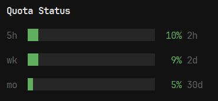
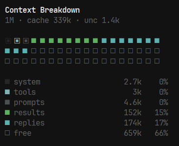

# opencode-plugins

Sidebar plugins for [OpenCode V2](https://opencode.ai/v2/docs/):

- **`quota-bars`** — OpenCode Go plan usage for the 5-hour / weekly / monthly windows as bars with percent and reset countdown.
- **`context-mosaic`** — a grid of squares showing what is occupying the current session's context window (system, tools, MCP, prompts, results, replies, free).

Each renders in the TUI sidebar and follows your theme.

## Screenshot




## Install

### Option 1 — config entry (recommended)

`~/.config/opencode/opencode.json`:

```jsonc
{
  "plugins": [
    "~/projects/opencode-plugins/quota-bars",
    "~/projects/opencode-plugins/context-mosaic"
  ]
}
```

Clone this repo to `~/projects/opencode-plugins` (or point the paths above at wherever you keep it — absolute paths like `/home/me/projects/…` also work).

Keep the repo *outside* `~/.config/opencode/plugins/` — every subdirectory there is treated as a discoverable plugin. Restart OpenCode after changing the list. The CLI auto-loads the TUI parts from the server's plugin list; no `cli.json` changes needed.

### Option 2 — with `opencode plugin add` (after the GitHub release)

`opencode plugin add` accepts **Git package specifiers** (and npm packages) — local paths are rejected. Once the repo is on GitHub, keep the root `package.json` manifest here, and both plugins install with one command instead of the manual config entry:

```sh
opencode plugin add github:imsorx/opencode-plugins
```

(Verified pattern: `plugin add github:<user>/<repo>` downloads the repo, registers it in the global configuration, and works for TUI-bearing packages — tested against another published OpenCode plugin; the CLI rejects local paths.)

## Notes

- `quota-bars` reads `https://opencode.ai/console/api/go/status` with the Console credential you already have via `/connect`; requires an OpenCode Console sign-in.
- `context-mosaic` measures the assembled request per model call (server-side hook), estimating component sizes with a ~4 chars per token heuristic. Totals and free space come from the model's reported usage and are exact; cache/uncached is a context-wide provider split.
- `context-mosaic` never touches credentials; `quota-bars` keeps the token in memory only and never logs or stores it.

## Disclaimer

These plugins (and this README) were **built with the help of AI** — behavior can be wrong or shift with OpenCode updates. Use at your own risk and peek at the source before trusting it.

## License

MIT
